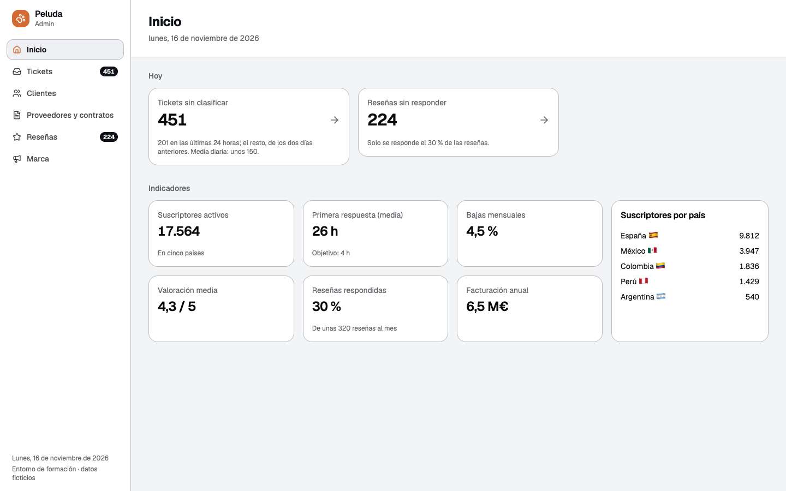
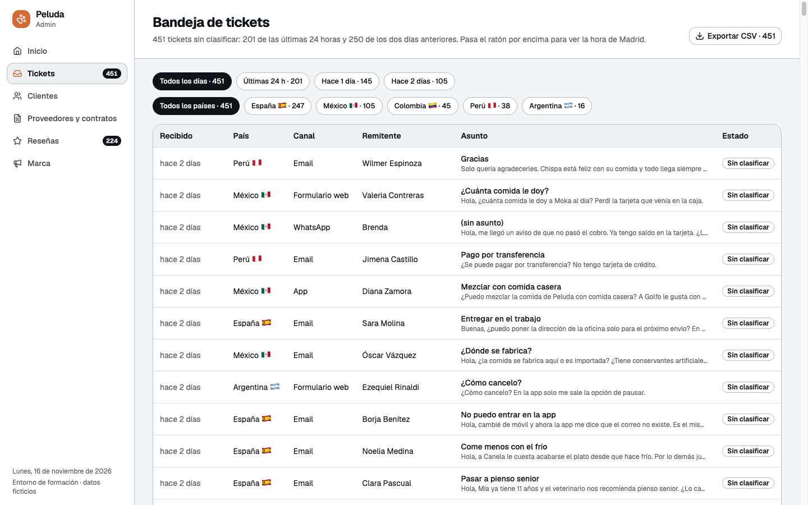
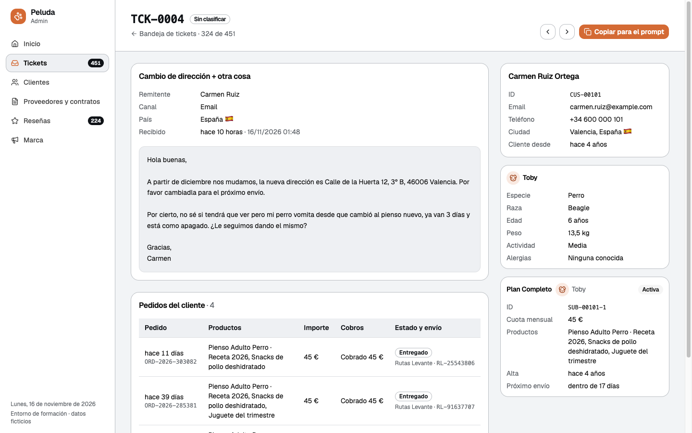
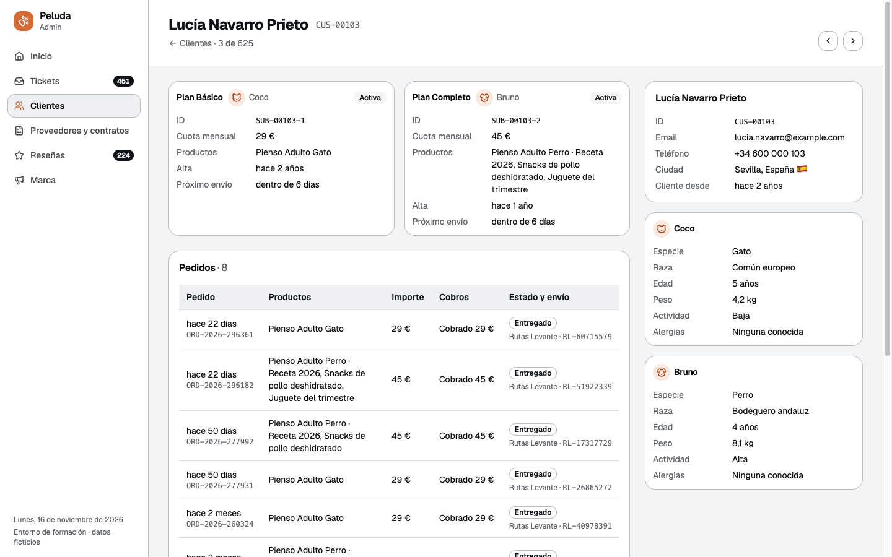
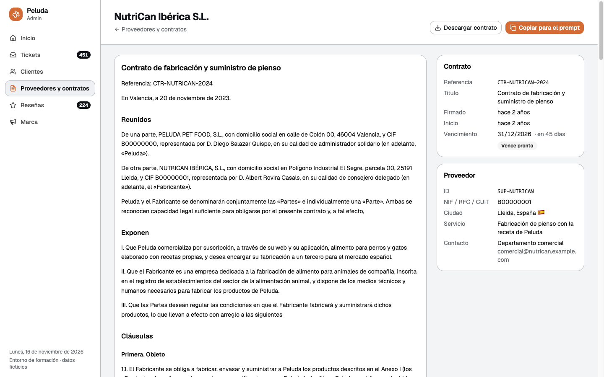
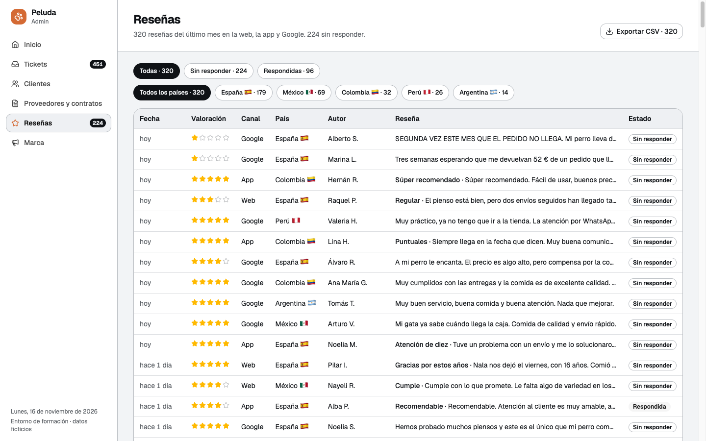

# Peluda Admin

**The backoffice of a pet-food company that does not exist.**
Tickets, customers, contracts and reviews to practise prompt engineering on.

## What this is

> [!WARNING]
> **Peluda is fictional.** The company, its customers, suppliers, contracts, tickets and reviews are all invented for a classroom. No real person, email, phone or tax ID is in here.

Peluda Admin is teaching material for the workshop *Prompt engineering estratégico* of the **Máster de FP en Inteligencia Artificial Aplicada a la Empresa** at **INESDI** (2026 edition). Students open it like a real support team would, copy a ticket, a contract or a review with **«Copiar para el prompt»**, paste it into a chat assistant and practise writing the prompt that handles it: classify the inbox, spot the trap in a contract clause, answer a review in the brand's voice.

The UI and the content are in Spanish; the code is in English.

## Screens

<table>
  <tr>
    <td width="50%"> <b>Ticket inbox</b> · 451 unclassified tickets, filters by day and country, CSV export</td>
    <td width="50%"> <b>Ticket detail</b> · the message next to the customer record, ready to copy into a prompt</td>
  </tr>
  <tr>
    <td> <b>Customer record</b> · subscriptions, pets, orders and charges, tickets and reviews</td>
    <td> <b>Supplier contract</b> · the full text, with the traps a good prompt should catch</td>
  </tr>
  <tr>
    <td> <b>Reviews</b> · web, app and Google reviews, answered and unanswered</td>
    <td>
      <b>Also inside</b>
      <ul>
        <li><b>Marca</b>: the brand voice guide, for writing replies</li>
        <li>Previous / next arrows that keep the list's filters</li>
        <li>«Exportar CSV» on every list, Excel-friendly (<code>;</code>, UTF-8 BOM)</li>
      </ul>
    </td>
  </tr>
</table>

## Contributing

How to run it, the commands, the data model and the stack: [`CONTRIBUTING.md`](CONTRIBUTING.md).

## License

[MIT](LICENSE) © 2026 Manuel Artero Anguita. Use it, fork it, run your own workshop with it.

Made for the INESDI 2026 prompt engineering workshop · Peluda, its pets and its people are made up 🐾

